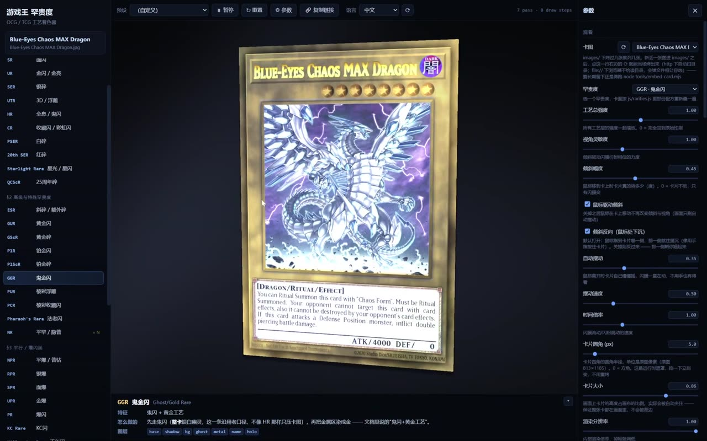
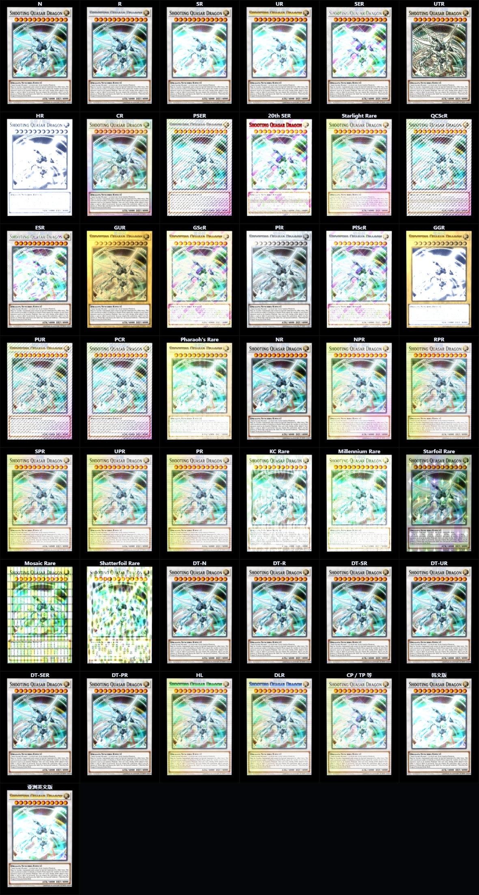
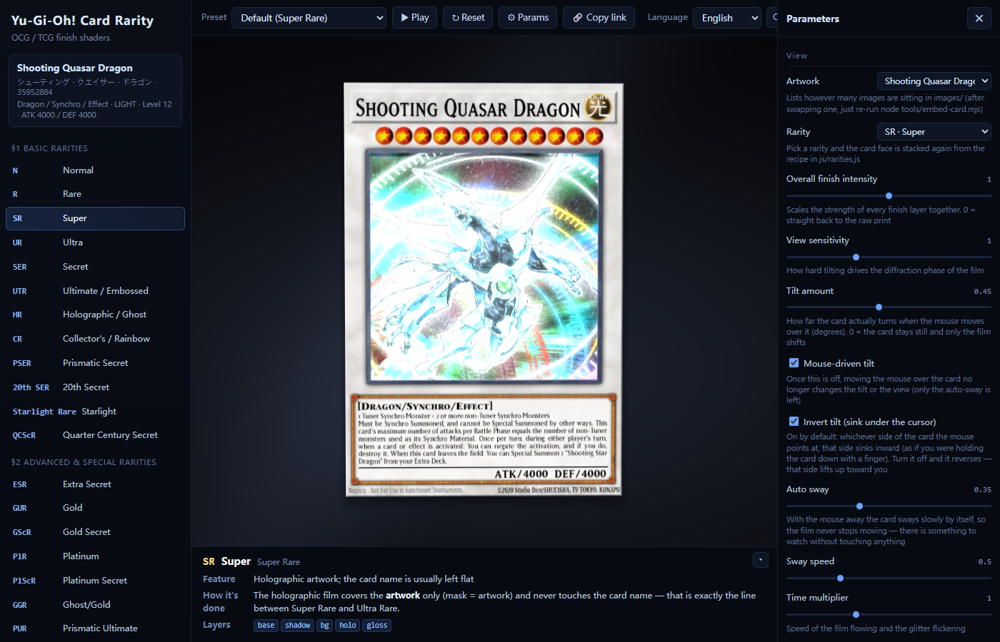
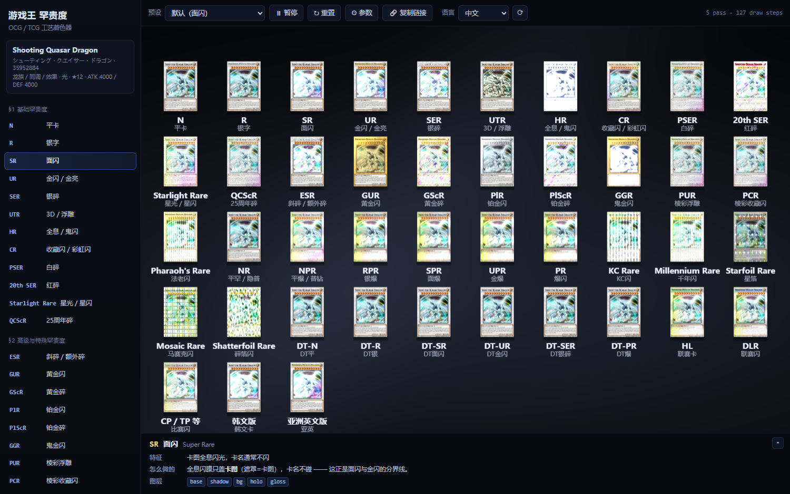
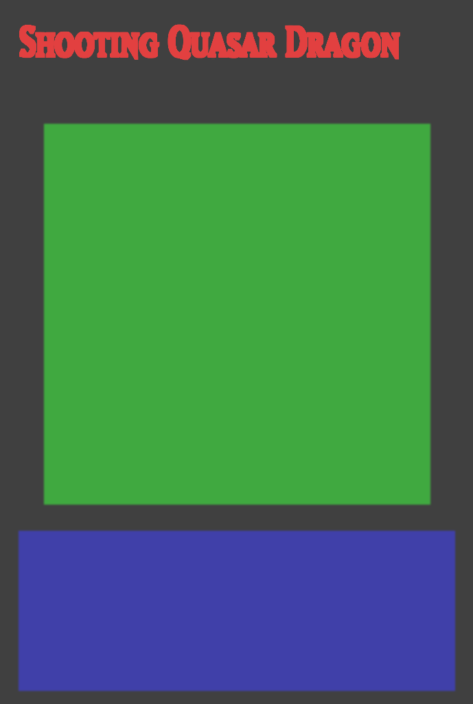

**English** · [中文](README.md)

# Yu-Gi-Oh Card Rarity · Craft Shaders

**One real Yu-Gi-Oh card + craft shaders for 43 rarities.**

> ### 🎬 Live preview (nothing to install)
>
> - **Interactive version (GitHub Pages)** → <https://zgdadong.github.io/Yu-Gi-Oh-Card-Rarity-Shader/>
> - **Preview video (42 seconds · 1080p · 10.9 MB)** → [`preview.mp4`](preview.mp4) | [video player page](preview.html)
>
> [](https://zgdadong.github.io/Yu-Gi-Oh-Card-Rarity-Shader/preview.html)

The card art is the `images/Shooting Quasar Dragon.jpg` you supplied — **Shooting Quasar Dragon**
(Dragon / Synchro / Effect · LIGHT · ★12 · ATK 4000 / DEF 4000).

The rarities aren't invented: **every one of them corresponds to
one entry in
[`docs/游戏王罕贵度总结（OCG  TCG）.md`](docs/游戏王罕贵度总结（OCG%20%20TCG）.md)**.
Where the document says "the art shimmers holographically, the card name usually doesn't", it renders as "the holo film covers the card art only";
where it says "the card name is in silver foil", only the card-name strokes get silver foil.

**The card art is swappable** — however many images sit under `images/` is however many it recognizes, picked in the "Card image" dropdown at the very top of the parameter panel.
Dropping in a new image **needs no node run**: click the **⟳** left of the dropdown and it is baked on the spot (see "Adding a new card image" below).
**The UI ships in Chinese / English / Japanese**, switched in the top right.

| What you want | Where to go |
| --- | --- |
| Everything on one page (43-rarity quick table / what can't be done / verification conclusions) | **[`docs/总结.md`](docs/总结.md)** |
| Implementation details (architecture / masks / all 17 shaders one by one / 43 recipes / swapping cards / i18n) | **[`docs/rarity-shaders.md`](docs/rarity-shaders.md)** |
| **Technical write-up** (how the render pipeline was built / problems found on review) | **[`docs/技术总结.md`](docs/技术总结.md)** |



The UI (Chinese / English / Japanese):



---

## How to run it

**Easiest: just open the online version** → <https://zgdadong.github.io/Yu-Gi-Oh-Card-Rarity-Shader/>
(the very same thing, deployed from this repo on GitHub Pages — and under `https://` the ⟳ next to "Card image" can even scan the directory by itself)

**Or download it and double-click `index.html`** — no external dependencies, no build step, runs fine under `file://`.

> Every script in the page is a **classic script** (not an ES module). The card images and masks are **embedded as data URIs**,
> not read from local files under `file://` — Chrome treats every local file as its own origin, and using a local `` for
> `texImage2D` gets rejected for a "tainted" origin.

A local server works too:

```powershell
cd "E:\ZG\Documents\DeepSeekHarness\P5.js\Art\Yu-Gi-Oh Card Rarity"
python -m http.server 8020      # 然后打开 http://localhost:8020
```

| Action | Effect |
| --- | --- |
| **Move the mouse onto the card** | The card **really rotates around the X/Y axes** (3D tilt in the vertex shader), and the holo film's diffraction phase follows those two angles — looking at the foil on a real card is exactly a matter of holding it and turning it slowly. **By default, whichever side the mouse points at sinks inward** (like a finger pressing on the card); to switch to "that side tilts up toward you", turn off "Tilt invert" in the panel |
| List on the left | The 43 rarities, grouped by the document's five sections; the small tag to the right of an entry marks it as "same craft as another one" |
| Info bar | The **document's own wording** for the current rarity (its characteristics) and **how it's made** (which shaders it uses) |
| <kbd>Space</kbd> / "⏸ Pause" | Pause / resume (while paused, changing a parameter repaints immediately) |
| <kbd>R</kbd> / "↻ Reset" | Reset the clock to zero |
| <kbd>P</kbd> / "⚙ Params" | The parameter panel (61 parameters / 4 groups: View / Craft / Region / Debug) |
| <kbd>M</kbd> | Mask debug overlay |
| Presets | **25**: Default / each individual rarity / ★mask debug / ★star·rank band only / ★attribute circle only / ★regions back to baked values / ★pattern atlas / ★★every rarity at a glance / ★★bare card face |
| "🔗 Copy link" | Writes the current 61 parameters into the address-bar hash and copies it |
| "Language" in the top right | Instant switching between Chinese / English / Japanese, with the choice remembered in localStorage; "⟳" rescans `Languages/` for newly dropped-in language packs |
| "▾" at the top right of the info bar | Collapse / expand the info bar (the collapsed state is remembered too) |
| "Card image" at the very top of the panel | Switch to another already-baked card (it lists however many there are) |
| The **⟳** left of the "Card image" dropdown | **Add a new card image**: scans `images/` for images that haven't been baked yet and bakes them on the spot into the dropdown. Under `file://` the browser won't let a page list directories, so a file picker pops up for you to choose manually (<kbd>Shift</kbd> + click = force the manual picker) |

---

## Adding a new card image

Drop the image into `images/` (the file name is the card id), then take one of two routes:

| | How | Result |
| --- | --- | --- |
| **A quick look** | Open the page and click the **⟳** left of the "Card image" dropdown | **Baked on the spot** in the browser, selectable immediately. It lives only in this page's memory, **gone on refresh** |
| **Kept for good** | `node tools/embed-card.mjs` | Regenerates `js/card-textures.js` (9 cards, a few minutes) and archives copies into `assets/`; it's there on every subsequent visit |

**Why ⟳ isn't as simple as "re-read the directory"**: the dropdown lists what's in `js/card-textures.js`, and the card image isn't read straight from `images/`
— each card also needs a **craft-region mask** (the name strokes are cut out of the image with Otsu, and the illustration and effect-box rectangles have to be mapped from the card's outer edge),
all of which is computed at bake time. So ⟳ has to **run a bake**, and what it calls is `js/bake.js` — the same implementation as `embed-card.mjs`.

The two routes differ only in how they learn there's a new image:

- `http://` (`python -m http.server`) → `fetch('images/')` reads the directory index, discovers new images automatically, fully hands-off
- `file://` (double-clicked) → the browser **refuses** to list directories, and a file:// image taints the canvas so `getImageData` throws
  `SecurityError` outright (this whole project embeds the card images as data URIs precisely to dodge that). So it opens a file picker instead,
  reads the file into a data URI with `FileReader` and bakes that — a file the user picked deliberately carries no origin restriction

---

## The 17 crafts

Every rarity is just **a stack of layers**, and each layer is one craft shader.
For the concrete parameters (what `uP0`/`uP1`/`uP2` mean, which rarities use them, and the measured deltas), see
[`docs/rarity-shaders.md` §5](docs/rarity-shaders.md).

| Category | Craft | What it does |
| --- | --- | --- |
| **Holo film** | `holo` | Wide-band holographic (the base of Super Rare) |
| | `parallel` | An extremely fine **irregular brushed** film over the whole card + a slowly shifting colour band along the perpendicular direction, so the whole rainbow sweeps across together as you tilt (Parallel/Explosive). **It used to be an evenly spaced line grating**, one line every 6.6px, which read like CRT scanlines — replaced; see [`docs/rarity-shaders.md` §4](docs/rarity-shaders.md) |
| | `diagonal` | A diagonal grating + per-cell random shard hues, with cracks blowing out to white (Secret Rare) |
| | `prismatic` | Two fine gratings crossing in opposite directions, with the intersections blowing out to white (Prismatic Secret Rare) |
| | `starfoil` / `mosaic` / `voronoi` | Star foil / mosaic / shard foil |
| **Pattern** | `kc` / `millennium` / `stamp` | Circuit-board film (**four copper layers**: grouped long traces + 45° corners + vias + keep-out gaps, **only the patch near the mouse is revealed — the window is ≈45% and fades from sharpest at the focus point outward**, with the palette ramping continuously blue→green→yellow→orange→red by distance from the cursor) / Egyptian-hieroglyph pattern film (plus small gold dots across the whole card, revealing at most 45% at any one angle) / 20th·25th watermark — see `docs/rarity-shaders.md` §4 |
| **Craft** | `emboss` | Treats the card face's brightness as a height field, takes the gradient for normals and lights it with a directional light (Ultimate Rare embossing) |
| | `ghost` | Silvery-white ghost (Ghost Rare): presses the **monster art frame** only, and at some angles slides into a Super-like holo |
| | `metal` | Gold / platinum foil: brightness is **mapped** to a metal colour + a brushed highlight |
| | `rainbow` | Takes the hue in polar coordinates around the highlight point, rotating with the mouse (Collector's Rare) |
| | `name` | Gold-foils / silver-foils / recolours the card-name strokes |
| **Additive light** | `glitter` / `gloss` | Fine sparkling points / a sweeping sheen (both go through additive blending) |

Plus 4 base pieces (`base` `shadow` `bg` `maskdebug`) = **21 fragment shaders**,
and one **3D tilt vertex shader**.

### The 43 rarities

| Section | Count | A few representative ones |
| --- | --- | --- |
| §1 Base | 12 | `N` Normal · `R` Rare · `SR` Super · `UR` Ultra · `SER` Secret · `UTR` Ultimate · `HR` Ghost · `CR` Collector's · `PSER` Prismatic Secret · `20th SER` 20th Secret · `Starlight` Starlight · `QCScR` Quarter Century Secret |
| §2 Advanced special | 10 | `ESR` Extra Secret · `GUR` Gold Ultra · `GScR` Gold Secret · `PlR` Platinum · `GGR` Ghost Gold · `PUR` Prismatic Ultimate · `PCR` Prismatic Collector's · `Pharaoh's` Pharaoh's · `NR` Normal Rare |
| §3 Parallel / Explosive | 10 | `NPR` Normal Parallel · `RPR` Rare Parallel · `SPR` Super Parallel · `UPR` Ultra Parallel · `PR` · `KC` · `Millennium` Millennium · `Starfoil` · `Mosaic` · `Shatterfoil` |
| §4 Duel Terminal | 6 | `DT-N` ~ `DT-PR` (crafts match the OCG namesakes, pointed at with `like:`, not copied out again) |
| §5 Other | 5 | `HL` Hobby League · `DLR` Duelist League · `CP/TP` tournament-pack foils · Korean version · Asian-English version |



---

## How it was made

### The card face is cut into four pieces

The difference between rarities lies **almost entirely in which piece gets the treatment**, so the card is cut into several pieces first
(the numbers were measured from brightness profiles taken by `tools/probe-card.mjs`, not copied off a spec sheet):

| Region | Description | Share |
| --- | --- | --- |
| **Card-name strokes** | **Cut out of the name band by darkness** and then dilated by 2px — no guessing at glyph positions, so it keeps up with any font | 1.85% |
| **Card art** | The illustration itself (excluding the dark frame around it) | 40.7% |
| **Effect box** | Includes the ATK/DEF band | 18.9% |
| **Card frame** | Whole card − card-art window frame − effect box (computed live from rectangles in the shader) | 37.2% |
| Card-art outer ring | Card-art window frame − card-art content | 3.2% |
| **Star / Rank band** | The strip between the name band and the card-art window, **full width** (Level stars sit right, Xyz Rank stars sit left, and one strip covers both) | Mask code 11 |
| **Attribute circle** | The circle after the name (LIGHT/DARK/EARTH/WATER/FIRE/WIND/DIVINE), handled as **a circular mask**, not a rectangular box | Mask code 12 |

For how the mask channels are assigned and how "the pieces of the card art are decided" works, see [`docs/rarity-shaders.md` §3](docs/rarity-shaders.md).
The last two pieces came later: the final 7 sliders of the panel's "Region" group tune them, the mask debug layer draws them in **orange / purple**,
and a recipe can treat them by filling in `SEL.STAR`(11) / `SEL.ATTR`(12) / `SEL.STAR_ATTR`(13, both at once) as its mask selection.
**SR / UR / SER / UTR already each carry a layer-13 pass** (star position and attribute are no longer just the original print — that's the post-Series-10 treatment; the per-rarity check and its sources are in §3); the gold-foil / platinum / rainbow / explosive ones use the "metal area / whole card face" masks, so they were covered already.
To see just these two pieces: the **★ star / rank band only** and **★ attribute circle only** presets.



### One trap: a partially covering layer repaints the whole card

`name` only treats the card-name strokes, so it was only natural to write `if (mask < 0.004) return tex;`.
But the returned `tex` carries `tex.a` (always 1 inside the card), which **amounts to that layer repainting the whole card** —
it pastes the original print back on top of what the previous layer did. The symptom is "no matter how you tune it, it's wrong", with no error at all:

- Gold Rare's border refuses to turn gold (after `metal` paints it as gold foil, the `name` layer wipes it back to silver)
- Stacking three emboss layers leaves only the last one doing anything
- Prismatic Secret is left with just the glitter and a white card name; the prismatic film disappears entirely

Switching to "**coverage as alpha**" fixed it: where `mask = 0` the alpha is 0, and that patch draws nothing.
Details in [`docs/rarity-shaders.md` §6](docs/rarity-shaders.md).

### And another one: canvas's premultiplied alpha eats the mask

The first version put the "card frame mask" in the alpha channel, so the G/B channels of the card-art window and effect box (card frame mask = 0 → alpha = 0)
got divided by 0 and erased during **un-premultiplication** — and the picture looked perfectly normal the whole time,
because the GPU upload uses the raw pixels from the `` and never goes through the canvas.
Now alpha is given over to "is this a pixel on the card", and `tools/verify.mjs` has a check dedicated to watching that round trip.

### 3D tilt

```
p = 卡片局部坐标 → 绕 Y 轴转 → 绕 X 轴转 → 透视投影
gl_Position.w = z / dist        ← 不是 1，这样纹理坐标按透视插值，卡面不会错位
uView = f(tilt.x, tilt.y)       ← 同样这两个角度驱动闪膜的衍射相位
```

The mouse's position on the card face decides the tilt angles, which is what makes "looking at the holo film" line up with the feel of a real card.

---

## Verification

```powershell
cd "E:\ZG\Documents\DeepSeekHarness\P5.js\Art\Yu-Gi-Oh Card Rarity"
node tools/verify.mjs        # 63 项自检
node tools/effects.mjs       # 43 个罕贵度 + 17 个工艺 + 61 个参数 + 25 个预设实测
node tools/doc-check.mjs     # 核对两份文档里可机器判定的说法（56 项）
node tools/gen-doc.mjs       # 改了 rarities.js 之后重填文档里的表
```

### `tools/verify.mjs` — all 63 checks PASS

```

-- A. 归档一致性 --
  PASS  生成物里记的每张卡 SHA-256 都与 assets/ 里的归档一致  —— 9 张全部一致
  PASS  images/ 里的原始卡图与 assets/ 归档一致（没被改过）  —— 6f4313494a38e490…
  PASS  归档文件用的是新文件名（35952884.jpg 已改名）  —— assets/Shooting Quasar Dragon.jpg

-- B. 纹理与掩膜 --
  PASS  掩膜从 data URI 解回来后的覆盖率与生成时记录一致（误差 < 0.5%）  —— 卡名 1.85% · 卡图 40.7% · 效果框 18.9% · 卡框 37.2%
  PASS  卡图 / 效果框掩膜能挺过一次 canvas 往返（预乘 alpha 没把它们抹掉）  —— 卡图 40.7% 效果框 18.9%
  PASS  四个区域加起来 ≈ 整张卡（差的那点是圆角与羽化边）  —— 合计 100.0% · 外环 3.2%
  PASS  卡片剪影（alpha 通道）在卡内处处为 1  —— 100.00%
  PASS  纹理尺寸与留白自洽（内容 = 纹理 ×(1−2×留白)）  —— 813×1185，留白 0%，圆角 0px
  PASS  卡片长宽比接近实卡的 59:86 = 0.6860  —— 实测 0.6717

-- C. 掩膜语义 --
  PASS  "卡名笔画"掩膜确实落在字上（与底板明显分离，方向符合自动判出的极性）  —— 极性 深字浅底 · 笔画区 0.190 vs 底板 0.361（分离 0.171，笔画 17871 px）
  PASS  卡名笔画占比合理（1% ~ 6%）  —— 1.85%
  PASS  卡图窗占比合理（35% ~ 55%）  —— 40.7%
  PASS  效果框占比合理（15% ~ 28%）  —— 18.9%
  PASS  卡框占比合理（20% ~ 40%）  —— 37.2%
  PASS  每张卡的卡名笔画占比都在 1% ~ 6%（没有哪张被整条名带填满）  —— A-to-Z-Dragon Buster 1.85% · Adamancipator Risen  1.84% · Blue-Eyes Chaos MAX  1.88% · Dragon Master Magia 1.75% · Meklord Astro Mekani 1.85% · Odin, Father of the  1.68% · Raidraptor - Rising  2.07% · Shooting Quasar Drag 1.81% · The First Darklord 1.61%
  PASS  每张卡的卡名极性都是自动判出来的，且两类亮度差够（≥ 0.12）  —— A-to-Z-Dragon Buster 深字浅底/0.318 · Adamancipator Risen  深字浅底/0.802 · Blue-Eyes Chaos MAX  深字浅底/0.426 · Dragon Master Magia 深字浅底/0.325 · Meklord Astro Mekani 深字浅底/0.419 · Odin, Father of the  深字浅底/0.815 · Raidraptor - Rising  白字黑底/0.741 · Shooting Quasar Drag 深字浅底/0.808 · The First Darklord 深字浅底/0.332

-- D. 罕贵度表 --
  PASS  罕贵度 id 唯一  —— 43 条
  PASS  LIST 与 ORDER 长度一致  —— 43 / 43
  PASS  每个图层引用的着色器都存在  —— 全部命中
  PASS  每条罕贵度都有"怎么做的"说明  —— 43 条都有
  PASS  图层参数合理（强度 > 0、遮罩码在 0..13）  —— OK
  PASS  每个工艺着色器都被至少一个罕贵度用到  —— 17 个工艺全部用上
  PASS  着色器清单齐备（工艺 17 + 基础 4）  —— 工艺 17 · 合计 21 个片段着色器
     分节: base=12 · high=10 · parallel=10 · dt=6 · other=5

-- E. 着色器编译与出图 --
  PASS  全部片段着色器编译通过  —— 21 个
  PASS  每个罕贵度都能出图（卡片区非全黑）  —— 最低 108.5
     GPU: ANGLE (Google, Vulkan 1.3.0 (SwiftShader Device (Subzero) (0x0000C0DE)), SwiftShader driver)

-- F. 确定性 --
  PASS  同一时间点重复渲染逐字节一致  —— 最大差 0
  PASS  时间推进后画面确实变了（时钟接通了闪膜的流动）  —— t=0 vs t=9 卡片区平均差 12.49（全屏 7.00）
  PASS  自动摆动真的在动  —— 摆动 0s vs 4s 平均差 19.34

-- G. 视角 / 倾斜 --
  PASS  鼠标左右移动会改变画面（3D 倾斜 + 衍射相位）  —— 平均差 21.23，最大 220
  PASS  倾斜幅度 = 0 时鼠标不动画面  —— 最大差 0
  PASS  关掉"鼠标驱动倾斜"后鼠标不动画面  —— 最大差 0

-- H. 布局：开合参数面板不能改变卡片的显示大小 --
  PASS  关着面板：画布 CSS 尺寸 = 绘制缓冲区尺寸  —— CSS 1012 · 缓冲区 1012 · 舞台 1012
  PASS  打开面板：舞台确实变窄了（否则这条检查没意义）  —— 1012 → 700
  PASS  打开面板后画布跟着重新分配尺寸（不是被 CSS 缩小）  —— CSS 700 · 缓冲区 700
  PASS  关掉面板后画布恢复到原尺寸  —— 1012
  PASS  卡片长宽比始终等于纹理长宽比（没有被拉伸）  —— 0.6861 vs 纹理 0.6861（A-to-Z-Dragon Buster Cannon）
  PASS  舞台很窄（420px）时卡片仍然整张在画面里，四边都没顶到画布边  —— 画布 420×656 · 卡片 416×606 · 非黑像素 x 2..417 y 25..630

-- I. 倾斜方向 --
  PASS  倾斜反向默认打开：鼠标那一侧往里沉（那一侧投影边界往中间收）  —— 鼠标在右 [78, 541] · 鼠标在左 [98, 560]
  PASS  关掉「倾斜反向」：方向确实反过来（那一侧朝你翘）  —— 鼠标在右 [98, 560] · 鼠标在左 [78, 541]
  PASS  两种方向确实是不一样的两幅画面（不是符号写反了却互相抵消）  —— 右边界 541 vs 560（差 19px）

-- J. hash 编解码 --
  PASS  hash 编解码往返一致  —— 61 个参数 → 237 字符
  PASS  非法/越界输入被丢弃或夹紧

-- K. 卡片外沿自动识别（合成用例） --
     识别  铺满整图  ·  both-axes  ·  长宽比 0.6711  ·  四边误差 [3, 3, 1, 1]
     识别  浅背景 + 投影（卡片占 47% 宽）  ·  both-axes  ·  长宽比 0.6703  ·  四边误差 [2, 0, 1, 1]
     识别  深背景 + 投影  ·  both-axes  ·  长宽比 0.6948  ·  四边误差 [0, 0, 1, 17]
     识别  浅背景 + 无投影（最难）  ·  both-axes  ·  长宽比 0.6740  ·  四边误差 [0, 0, 1, 1]
  PASS  铺满整图的卡：识别出的外沿就是整张图  —— 最大误差 3px
  PASS  浅背景 + 投影（卡片只占 47% 宽）：能识别出来，且四边误差 ≤ 20px  —— 最大误差 2px（用 both-axes）
  PASS  深背景 + 投影：能识别出来，且四边误差 ≤ 25px  —— 最大误差 17px
  PASS  浅背景 + 无投影（最难的一种）：仍然不会崩（要么认对，要么老实地退化）  —— 最大误差 1px
  PASS  识别出的长宽比都在游戏王卡的 59:86 附近（±0.03）  —— 0.6711 · 0.6703 · 0.6948 · 0.6740

-- L. 多卡图 --
  PASS  images/ 下的每张卡都进了 CardTextures  —— 9 张：A-to-Z-Dragon Buster Cannon · Adamancipator Risen - Dragite · Blue-Eyes Chaos MAX Dragon · Dragon Master Magia · Meklord Astro Mekanikle · Odin, Father of the Aesir · Raidraptor - Rising Rebellion Falcon · Shooting Quasar Dragon · The First Darklord
  PASS  生成物里的卡数与 images/ 下的图片数一致  —— 9 张
  PASS  卡片外沿是自动识别出来的，且比例像游戏王卡（0.60~0.78）  —— A-to-Z-Dragon Buster Cannon: 识别 0.6717 · Adamancipator Risen - Dragite: 识别 0.6726 · Blue-Eyes Chaos MAX Dragon: 识别 0.6726 · Dragon Master Magia: 识别 0.6717 · Meklord Astro Mekanikle: 识别 0.6726 · Odin, Father of the Aesir: 识别 0.6726 · Raidraptor - Rising Rebellion Falcon: 识别 0.6717 · Shooting Quasar Dragon: 识别 0.6726 · The First Darklord: 识别 0.6717
  PASS  自动识别出的外沿与手工量的一致（这张卡是 26,26 → 787,1157，允许 ±3px）  —— 26,26 → 788,1159
  PASS  圆角不再烤进纹理（改由运行时的 uCardRound 控制）  —— 0px
  PASS  切到别的卡之后画面确实变了  —— A-to-Z-Dragon Buster Cannon 0.0 · Adamancipator Risen - Dragite 56.0 · Blue-Eyes Chaos MAX Dragon 45.8 · Dragon Master Magia 31.5 · Meklord Astro Mekanikle 47.3 · Odin, Father of the Aesir 56.9 · Raidraptor - Rising Rebellion Falcon 53.1 · Shooting Quasar Dragon 57.2 · The First Darklord 34.5
  PASS  切回第 0 张能逐字节回到原样  —— 最大差 0

-- M. 多语言 --
  PASS  清单里的每个语言包都加载成功  —— zh-CN✓ en-US✓ ja-JP✓
  PASS  每个语言包的键集合与 zh-CN 完全一致  —— zh-CN 347 键 · en-US 347 键 · ja-JP 347 键
  PASS  切换语言后界面文案真的变了（标题 / 罕贵度名 / 分节 / 参数组 / 预设）  —— zh-CN: 平卡 / 观看 · en-US: Normal / View · ja-JP: ノーマル / 表示
  PASS  缺键回退到 zh-CN（不是显示裸键）  —— 中文兜底
  PASS  所有语言都没有的键才回退成键名本身  —— __definitely_missing__
  PASS  切语言记进了 localStorage  —— stored=zh-CN

-- N. 控制台 --
  PASS  页面无未捕获异常  —— 无
  PASS  控制台无 error  —— 无

-- O. 出图 --
  PASS  截图写出  —— E:\ZG\Documents\DeepSeekHarness\P5.js\Art\Yu-Gi-Oh Card Rarity\tools\.cache\verify-preview.png

================================================================
RESULT: PASS  （63 项全过）
```

### `tools/effects.mjs` — 43 + 17 + 61 + 25 all measured

```
-- ① 每个罕贵度相对"平卡 N"改了什么 --
  罕贵度        图层                        均值差   变化像素
  N            （无）                       0.00     0.0%     ← 本来就与平卡完全相同
  R            name                         3.40     2.4%
  SR           holo+gloss+holo              25.58    47.1%     ← 末层是星位+属性（遮罩码 13）
  UTR          emboss+emboss+emboss+emboss  19.31    55.6%     ← 同上
  HR           ghost+emboss                12.31    40.6%     ← 幽灵只压怪物图框（卡图占 44%）
  GUR          metal+metal+name            31.70    81.2%
  KC Rare      holo+gloss+name+kc           17.25    48.8%     ← 鼠标附近那一块显形（≈45%）
  Millennium   millennium                   8.00    21.9%     ← 一个角度只显形 20% 上下
  DT-SR        holo+gloss+holo             25.58    47.1%     ← 与 SR 逐像素相同（like: 继承）
  DT-PR        parallel                    35.20    99.0%     ← 与 PR 逐像素相同
  NR           （无）                       0.00     0.0%     ← 本来就与平卡完全相同

-- ② 逐工艺单独作用（借 SR 的位置，只留这一层）--
  holo 20.27 · parallel 33.62 · diagonal 24.01 · prismatic 40.44 · starfoil 23.50
  mosaic 39.08 · voronoi 49.47 · kc 3.69 · millennium 16.02 · emboss 16.16
  ghost 24.90 · metal 21.41 · rainbow 10.92 · name 3.09 · glitter 1.12 · stamp 0.91 · gloss 5.52
  ↑ glitter / stamp / name 是"小面积但很强"（单通道最大差 80~255），所以均值差看着小；
    kc / millennium / ghost 现在也小 —— 前两个**只显形一部分**（45% / 20%），
    ghost 只压怪物图框，都是设计要求（见 §4 图案膜的"可见窗口"）

-- ③ 逐参数（「区域」那 20 根各自配一层"只加工那一块"的膜）--
  artOuter* 2.86~19.91 · artInner* 3.91~19.56 · textBox* 0.65~34.54 · regionManual 0.57
  starX0 0.10 · starY0 6.19 · starX1 2.90 · starY1 2.90        ← 星数 / 阶数带（遮罩码 11）
  attrX 0.27 · attrY 0.27 · attrR 0.16                          ← 属性圆（遮罩码 12）
  demoRegion 2.05                                               ← 区域演示层

RESULT: 43 个罕贵度 · 17 个工艺 · 61 个参数 · 25 个预设全部检查过（参数 61/61 接通）
```

> Whether a parameter counts as "wired up" is judged from the **per-pixel difference over two regions, the card area and the full frame**, and three cases are accepted:
> a large gentle change (mean difference > 0.6), a small but stronger change (> 0.4% of pixels with a single-channel difference > 24),
> or a tiny but very strong change (single-channel difference > 60 — white flashes and sweeping sheens light up only a small patch).
> Some parameters are **the phase of a periodic function**, so for float parameters the scan tries a few candidate values and takes the one with the most visible effect.
>
> The 20 "Region" sliders used to be judged "not wired up" by this scan, and that was **the wrong test conditions**: geometric parameters only show
> on "the layer that treats that piece", and on a synthetic card the full-card films laid down afterwards covered the earlier ones.
> Now each slider gets a film of its own that keeps only that layer and picks that piece as its mask (star band → 11, attribute circle → 12,
> card-art frame → 7, illustration → 1, effect box → 4), so all of them measurably take effect.

---

## Things that actually got fixed during verification

Every one of these was caught by tooling; you can't spot them by eyeballing the picture:

1. **A partially covering layer repaints the whole card** — flushed out by `effects.mjs`'s "each craft on its own" scan:
   turning `mHolo` down to 0 changed the picture not at all. It wasn't a disconnected parameter, it was **a wrong compositing model** (see above).
2. **With "mouse-driven tilt" off, the frozen frame still followed the mouse**
   — `renderAtTime` carried its own copy of the tilt maths, and that copy had dropped the `hoverOn` check
   (measured: moving the mouse left and right still gave a single-channel maximum difference of **252**). Live rendering and frozen rendering now share one `targetTilt()`.
3. **A `'0'` in the hash read as "on"** — `clampParam` wrote `v ? 1 : 0` for check-type parameters,
   but what comes out of a hash is a string, and `'0'` is **truthy** in JS. Changed to `Number(v) ? 1 : 0`.
4. **Canvas's premultiplied alpha ate the masks** — see above.
5. **Turning `nameTintOn` on was the same as leaving it off** — the default card-name colour `#d8e4ff` is nearly identical to Rare's silver,
   so the per-parameter scan judged it "not wired up" outright. Replaced with an obviously different cyan.
6. **`shadowOn` was judged "not wired up"** — not because no shadow was drawn, but because the shadow offset was only 1% of the canvas height and
   almost entirely hidden behind the card. Only after enlarging it to 1.7% / 1.032× did it become genuinely visible.
7. **The two tilt axes went in opposite directions** — moving the mouse right gave "the right side tilts up toward you", while moving it down gave "the bottom side sinks inward".
   Either direction made sense on its own; move the mouse diagonally and you'd catch the two fighting each other. A single "Tilt invert" control now governs it,
   defaulting to "whichever side the mouse points at sinks inward".
8. **Opening the parameter panel shrank the card** — the canvas only listened to the window's `resize`, while opening and closing the panel changes a CSS grid and
   fires no window event. With the stage narrower, the canvas kept its old size and was displayed scaled down by CSS. Switched to a `ResizeObserver` watching the stage.
9. **The card-face sheen was dead 40% of the time** — `gloss` built its sweeping band with `max(sin, 0)`,
   and while it swept past, the whole layer stayed completely dark (measured: from t=2s to t=5s — a full four seconds — the card area's mean difference was exactly 0).
   Changed to `abs(sin)` plus a permanent base glow.

---

## Known trade-offs (nothing hidden)

- **The ones that can't be done**: `NR`'s only distinguishing feature is its **pull rate** (pixel-for-pixel identical to a Normal,
  and this project does not change a single pixel for it); `UTR`'s "you can feel the relief under your finger" can't be rendered; for `CP/TP` the document itself says
  "printings vary a lot", so it gets one indicative recipe only; the Korean version / Asian-English are not a new craft but a **release version**.
  The full list and the reasoning are in [`docs/rarity-shaders.md` §8](docs/rarity-shaders.md).
- **The "Egyptian writing" on Millennium / Pharaoh's is a stylistic approximation**, not researched hieroglyphic glyphs —
  four pictograms (ankh / Eye of Horus / cartouche / water-bird) are drawn on the fly with canvas 2D and assembled randomly per cell.
- **The ones whose shape the document doesn't pin down** (`Starlight` / `PSER` / `QCScR` all just say "a holo film covers the whole card")
  are made into three different films by eye, so that they **look distinguishable** — that's my call, not something the document says.
- **The set code on the card face is untouched**: it's printed on the card, it isn't in the image either, and altering it would amount to forging the card face.
  The rarity code is shown in the page's info bar instead.
- **This project does not do prices at all** — §7 of the document also stresses that "rarity is not price".
- **When you swap in another card, the card frame / card-art window / effect box rectangles are proportions hard-coded for the Yu-Gi-Oh standard layout, shared by every card.**
  Synchro, Effect and Normal monsters are all fine, but Pendulum cards (which add a Pendulum zone), Link monsters (which have no Level stars) and
  non-Effect monsters don't line up, so they have to be overridden per file name in the `CARDS` table at the top of `tools/embed-card.mjs`.
  **The polarity of the card-name cut-out is detected automatically** (Otsu threshold + minority-is-ink, `NAME_INK.auto` in `js/bake.js`),
  so a genuine gold-rare original with gold lettering on a dark red background recognizes itself too; and if some card does get detected wrong,
  pin it down by writing `nameInk: { auto: false, lo, hi }` in the `CARDS` table in `js/bake.js`.
- **Language packs are .js, not .json**: `fetch('./Languages/xx.json')` gets blocked by CORS under `file://`,
  and this project has to run by double-clicking index.html. So a language pack is written as a single `CardI18nPack['xx'] = {...}` statement and
  injected with `<script>`. The mechanics (localStorage / missing-key fallback / `{var}` interpolation / instant switching in the dropdown) match
  what the neighbouring `Three.js-3D-Earth` write-up describes; only the loading method differs.
- **The holo film's animation (`uTime`) is my addition**: a real card doesn't move when you don't look at it, but on screen a bit of flow is what makes it read as "foil".
  You can dial "Time scale" down to 0 in the panel.

---

## Provenance and licensing

- **Every shader is written by me**, and no shader code was lifted from any game.
  The organization (the "one sprite texture + draw steps stacked one after another" approach, and the `texture_details` / `image_details`
  sprite protocol) follows the neighbouring `card-shader/` project's write-up of the Balatro render pipeline:
  [`../card-shader/docs/balatro-shaders.md`](../card-shader/docs/balatro-shaders.md).
- **The card image `images/Shooting Quasar Dragon.jpg` was provided by you**, and I have no information about its source or licensing;
  all rights to the card itself and to everything related to 「遊☆戯☆王」 belong to **Studio Dice / SHUEISHA / TV TOKYO / KONAMI**.
  The image carries its own "Replica - Not For Use in Sanctioned Tournaments" watermark.
  **For study and research only, not for commercial use**; confirm the licensing yourself before distributing it.
- `js/`, `index.html`, `css/`, `tools/`, `docs/rarity-shaders.md`: written by me for this project, use them however you like.
- `docs/游戏王罕贵度总结（OCG  TCG）.md` is the original document you provided, and **I haven't changed a single character of it**.

---

## File structure

```
Yu-Gi-Oh Card Rarity/
├── index.html
├── preview.html                 video page on GitHub Pages (a README can't embed an mp4)
├── css/style.css
├── .nojekyll                    tells Pages to skip Jekyll and serve the repo as-is
├── README.md  README.en.md       Chinese / English
├── images/                      **drop your card images here** — every file found is baked; the filename is the card id
│   └── Shooting Quasar Dragon.jpg
├── assets/                      byte-for-byte archive of the originals (verify checks the SHA-256)
├── Languages/                   language packs, one .js per language
│   ├── languages.js             the manifest (adding a language only touches this file)
│   ├── zh-CN.js  en-US.js  ja-JP.js
│   └── 语言代码说明.txt          BCP 47 notes + how to add a language
├── js/
│   ├── card-textures.js         **auto-generated**: card image + masks (data URI) + region table + SHA-256
│   ├── detect.js                card outline detection (shared by the page and tools/)
│   ├── bake.js                  baking core: texture + craft-region masks (shared by the page and tools/)
│   ├── card-refresh.js          the ⟳ next to "Card image": scan images/ or pick a file, bake it on the spot
│   ├── i18n.js                  i18n loader: t / tOr, localStorage, missing-key fallback to zh-CN
│   ├── stamps.js                pattern atlas: KC / 20th / 25th / hieroglyphs drawn with canvas 2D at runtime
│   ├── shaders.js               17 crafts + 4 base pieces + the 3D tilt vertex shader
│   ├── rarities.js              43 rarities → shader recipes
│   ├── config.js                61 parameters + 25 presets + hash encode/decode
│   ├── pipeline.js              multi-pass pipeline, 3D tilt, grid mode, pixel readback
│   └── ui.js                    rarity list / info bar / parameter panel / language dropdown / hash sync
├── docs/
│   ├── 游戏王罕贵度总结（OCG  TCG）.md     the original reference document (untouched)
│   ├── rarity-shaders.md                  **rarity → shader**: architecture / masks / shader-by-shader / all 43 recipes
│   ├── 总结.md                            **one-page summary**: 43-rarity cheat sheet / what can't be done / verification
│   ├── 技术总结.md                        implementation summary: render pipeline / shader inventory / findings
│   └── mask-preview.png                   mask preview
├── tools/
│   ├── analyze-card.mjs         row/column edge-strength profiles
│   ├── probe-card.mjs           point luma profiles + zoomed crops (for measuring boundaries)
│   ├── embed-card.mjs           card image + mask baking (calls js/detect.js + js/bake.js, same source as the page)
│   ├── lib/detect.mjs           → the source text of js/detect.js
│   ├── lib/bake.mjs             → the source text of js/bake.js
│   ├── gen-doc.mjs              refills the auto-generated tables in the docs
│   ├── doc-check.mjs            machine-checks the claims made in the docs
│   ├── verify.mjs               63 self-checks
│   ├── effects.mjs              per-rarity / per-craft / per-parameter / per-preset measurements
│   ├── gen-lang.mjs             generates Languages/zh-CN.js from the strings in js/
│   ├── shot.mjs / montage.mjs   single shot / montage
│   └── node_modules → playwright-core borrowed from the neighbouring card-shader project (junction link)
└── preview.mp4 / preview-video.jpg / preview.png / effects.jpg / sheet.png / panel.png / panel-en.png
```
